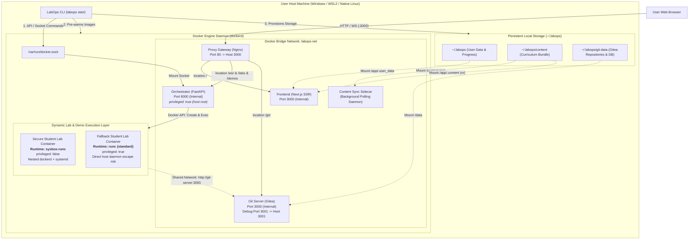
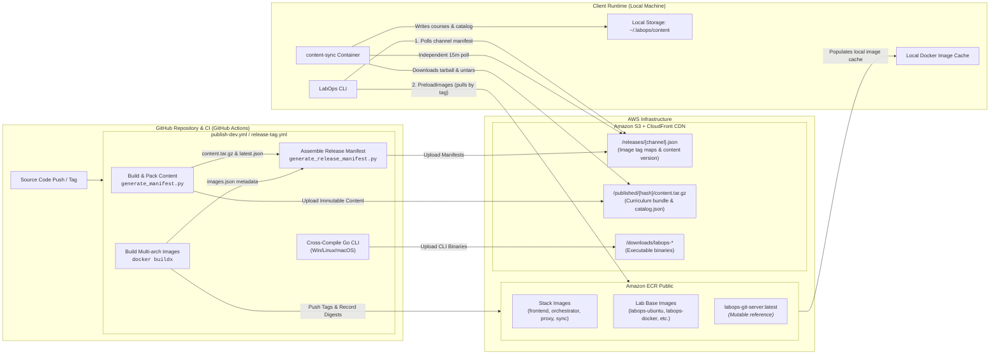
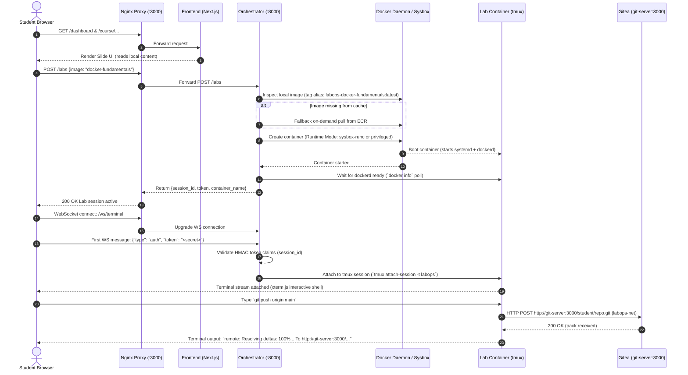

# LabOps System Architecture & Delivery Reference

This document provides a technically grounded reference of the LabOps architecture based on current implementation code in the repository.

It is structured into three concrete architectural views:
1. **System Deployment & Runtime Topology**
2. **Release, Publishing & Artifact Delivery**
3. **Interactive Lab Execution & Lifecycle Flow**

---

## Technical Baseline & Verified Implementation Findings

Before inspecting the architectural views, the following source-level behaviors are verified:

1. **Tag-Based Image Pulls (Digest Metadata Only)**:
   - In [`cli/update.go`](file:///d:/vanshmalanidata/Document/GitHub/SGP-V/cli/update.go#L95-L108) and [`cli/start.go`](file:///d:/vanshmalanidata/Document/GitHub/SGP-V/cli/start.go#L450-L485), `GetManagedImages` reads `meta.Remote` (e.g. `public.ecr.aws/.../labops-frontend:v0.4.0`) and passes it directly to `docker pull <imageName>`.
   - The SHA-256 digest recorded in the manifest (`meta.Digest`) is logged as audit metadata in the release manifest and `images.json`, but the CLI currently executes pulls by **tag name**, not by immutable content digest (`repo@sha256:...`).
2. **Mutable Gitea Component**:
   - `git-server` references `labops-git-server:latest` with an empty digest string (`"digest": ""`). It is not pinned to channel-specific releases, making it mutable across deployments.
3. **Dual Runtime Modes (Sysbox vs. Privileged Fallback)**:
   - When running on a supported Linux host or inside WSL2 where `sysbox-runc` is present, `CONTAINER_RUNTIME_MODE=sysbox` is active (`runtime: "sysbox-runc"`, `privileged: false`).
   - When running under Docker Desktop or environments lacking Sysbox, the system falls back to `CONTAINER_RUNTIME_MODE=privileged` (`runtime: runc`, `privileged: true`).

---

## View 1: System Deployment & Runtime Topology

This view illustrates the physical host boundaries, the programmatic container initialization by the CLI, network routing, and volume mount relationships.

---

## View 2: Release, Publishing & Artifact Delivery

This view traces code modifications through the GitHub Actions release pipeline to Amazon S3, CloudFront, and ECR Public, highlighting how the CLI and `content-sync` sidecar retrieve separate artifacts.

---

## View 3: Interactive Lab Execution & Session Lifecycle

This view details the end-to-end request flow when a student navigates a curriculum slide, launches a terminal, and interacts with the lab environment.

